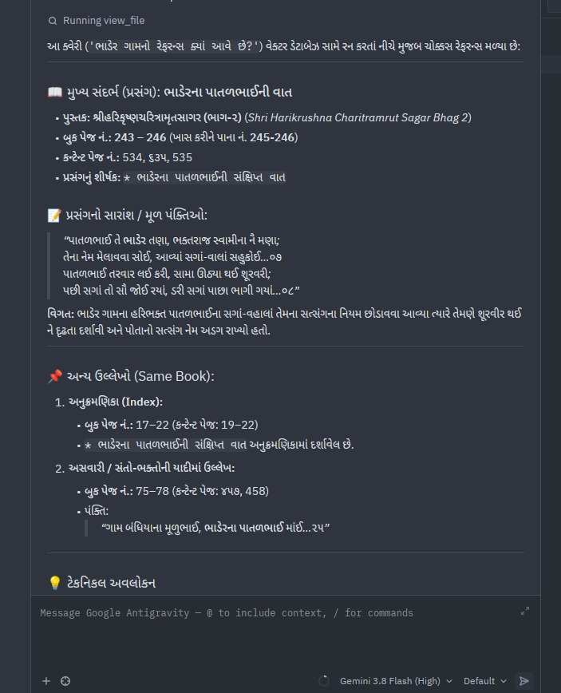

# find-book-reference

Feed book data to AI, find reference of data from book using Natural Language.

A semantic search and Retrieval-Augmented Generation (RAG) system built for Gujarati scripture literature. It enables natural language queries against large book collections and delivers exact, verifiable source citations down to the book title, chapter, printed book page number, and digital content page number.

---

## 📸 Example Result

Here is an example query run against the vector database searching for references to the village **Bhader** (*ભાડેર*):



### What this sample demonstrates:
- **Natural Language Query**: Querying in colloquial Gujarati (`ભાડેર ગામનો રેફરન્સ ક્યાં આવે છે?`).
- **Exact Primary Reference**: Identifies the main event (*ભાડેરના પાતળભાઈની વાત*) in *શ્રીહરિકૃષ્ણચરિત્રામૃતસાગર (ભાગ-૨)* (*Shri Harikrushna Charitramrut Sagar Bhag 2*).
- **Dual Page Precision**: 
  - **Printed Book Pages**: `243 – 246` (focusing on `245 – 246`).
  - **Digital / Content Pages**: `534, 535, 536`.
- **Original Text & Summary**: Excerpts the poetic verses alongside a clear event summary.
- **Cross-References**: Identifies additional occurrences in the same book, including index listings (pages `17–22`) and lists of devotees (pages `75–78`).

---

## ✨ Features

- **Gujarati Natural Language Search**: Query historical events, people, places, or moral teachings using everyday language.
- **Exact Source Citations**: Pinpoints exact book titles, chapters, printed book pages, and PDF content pages.
- **Dense Multilingual Vector Retrieval**: Powered by [Qdrant](https://qdrant.tech/) and the `intfloat/multilingual-e5-large` embedding model.
- **Structured Metadata Filtering**: Filter queries specifically by **book title**, **person**, or **place/village**.
- **Dual Query Modes**:
  - **Fast Vector Retrieval (`--no-llm`)**: Instant semantic lookup with zero LLM inference cost.
  - **Full RAG (`--backend openai` or `--backend agy`)**: Comprehensive answer synthesis with cited passages.
- **Interactive REPL Mode**: Keeps embedding models loaded in memory for near-instant repeated querying.

---

## 🚀 Quick Start

### 1. Setup Environment

```bash
# Activate virtual environment
source .venv/bin/activate

# Install required dependencies if needed
pip install qdrant-client sentence-transformers torch
```

### 2. Run Queries

#### Fast Vector Search (Search-Only)
```bash
python scripts/t4_query.py -q "ભાડેર ગામનો રેફરન્સ ક્યાં આવે છે?" --no-llm
```

#### Filtered Search (by Place, Person, or Book)
```bash
# Filter by place
python scripts/t4_query.py -q "પાતળભાઈની વાત" --place "ભાડેર" --no-llm

# Filter by person
python scripts/t4_query.py -q "દર્શન આપ્યા" --person "માધવદાસ સ્વામી" --no-llm

# Filter by book title
python scripts/t4_query.py -q "ચમત્કાર" --book "Shri Harikrushna Charitramrut Sagar Bhag 2" --no-llm
```

#### Interactive Mode (Fastest for multiple questions)
```bash
python scripts/t4_query.py --interactive
```

#### Full RAG with LLM Generation
```bash
# Using a local OpenAI-compatible endpoint (llama-server, vLLM, Ollama)
python scripts/t4_query.py -q "ભાડેરના પાતળભાઈનો પ્રસંગ શું છે?" --openai-url http://localhost:8080/v1

# Using Antigravity CLI
python scripts/t4_query.py -q "ભાડેરના પાતળભાઈનો પ્રસંગ શું છે?" --backend agy
```

---

## 🛠️ Pipeline Architecture

1. **OCR Extraction (`data/ocr_output/`)**: Extracted Markdown and structured JSON bounding boxes from scanned book PDFs.
2. **Metadata Extraction (`scripts/t1_extract_metadata.py`)**: Extracts page numbers, section headers, topics, places, and people into `data/extracted_metadata/`.
3. **Data Preparation (`scripts/t2_prepare_data.py`)**: Merges OCR content with extracted metadata into searchable passages.
4. **Vector Indexing (`scripts/t3_index_data.py`)**: Computes dense vector embeddings and indexes into Qdrant (`data/vector_db/`).
5. **Query & Retrieval (`scripts/t4_query.py`)**: Production semantic search and RAG synthesis engine.

For complete query guide and CLI options reference, see [how_to_use_vector_db.md](how_to_use_vector_db.md).

---

## 📁 Repository Structure

```text
find-book-reference/
├── data/
│   ├── extracted_metadata/   # Extracted JSON page metadata
│   ├── ocr_output/           # OCR markdown & JSON files
│   └── vector_db/            # Local Qdrant vector database storage
├── examples/
│   └── sample1.jpeg          # Sample query output screenshot
├── scripts/
│   ├── t1_extract_metadata.py # Page metadata extractor
│   ├── t2_prepare_data.py     # Data prep & chunking
│   ├── t3_index_data.py       # Qdrant vector indexer
│   ├── t4_query.py            # CLI query tool & RAG engine
│   └── prompts.py             # LLM prompts
├── how_to_use_vector_db.md    # Detailed vector DB & query documentation
├── claude_plan2.md            # Architecture & implementation plan
└── README.md
```
