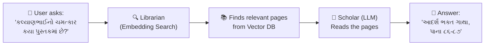
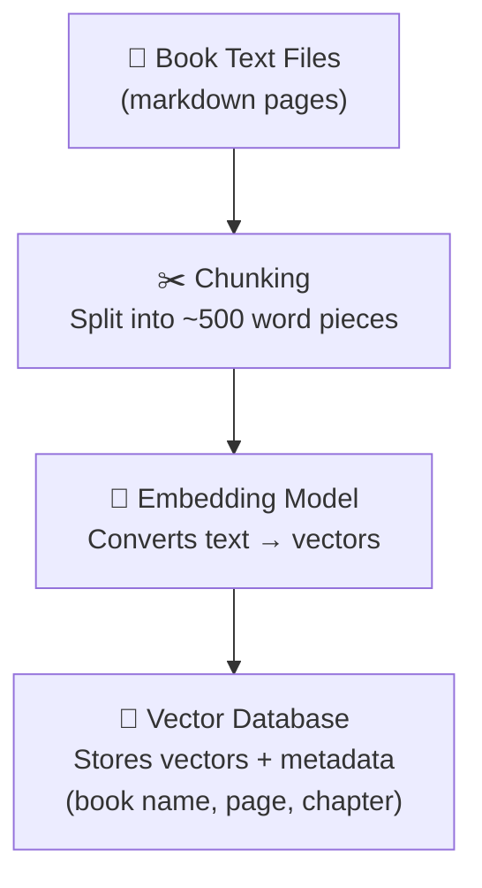
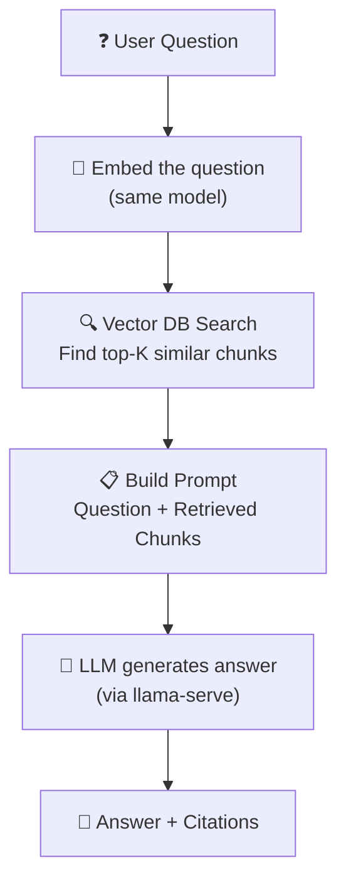
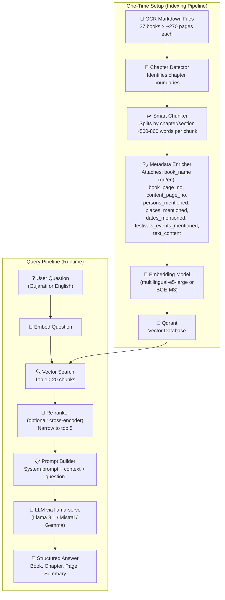
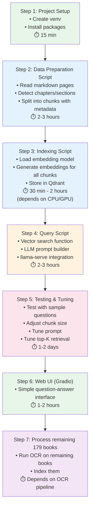

# 📚 Gujarati Scripture Reference Finder — Complete Plan

## Your Data at a Glance

| Item | Details |
|------|---------|
| Source books (PDFs) | ~206 books at `../text-extract/books/` |
| OCR-extracted pages | ~7,249 markdown pages + ~7,780 JSON pages |
| Books processed so far | 27 (both in `../text-extract/data/ocr_output/` and copied to `data/ocr_output/`) |
| Total extracted data size | ~138 MB |
| Data format per page | **Markdown** (plain text) + **JSON** (structured: blocks with bounding boxes, section headers, paragraphs, page numbers) |
| Language | Gujarati (with some Sanskrit shlokas) |

---

## 1. RAG vs Fine-Tuning vs Hybrid — Which Approach?

There are **3 main approaches** to make an LLM answer questions from your book data. Here's a comparison:

### Option A: RAG (Retrieval-Augmented Generation) ✅ **RECOMMENDED**

```
User Question → Search vector DB → Retrieve relevant chunks → Feed to LLM → Answer with source citation
```

**How it works:**
1. You split your book text into small chunks (e.g., 500-1000 words each)
2. Each chunk is converted into a numerical "embedding" (a vector that captures the meaning)
3. These vectors are stored in a vector database
4. When user asks a question, the question is also converted to a vector
5. The database finds the chunks whose vectors are most similar (semantically) to the question
6. Those chunks are pasted into the LLM prompt as "context"
7. The LLM reads the context and answers the question, citing the book/chapter/page

| Pros | Cons |
|------|------|
| ✅ **No GPU training needed** — just indexing | ❌ Quality depends on retrieval — if wrong chunks are fetched, LLM will give wrong answer |
| ✅ **Always cites exact source** (book, page, chapter) | ❌ Very large context windows needed for complex cross-book questions |
| ✅ **Easy to update** — add new books by indexing them | ❌ Embedding models may not work perfectly for Gujarati text |
| ✅ **Works with any LLM** — even your local `llama-serve` model | |
| ✅ **Data stays private** — everything runs locally | |
| ✅ **Cost: Free** (if using local models) | |

### Option B: Fine-Tuning / Training

```
Book data → Create Q&A training pairs → Fine-tune LLM weights → Model "remembers" the data
```

**How it works:**
1. You create thousands of (question, answer) pairs from your book data
2. You re-train (fine-tune) an LLM on these pairs
3. The model's weights change to "memorize" this knowledge
4. At inference time, the model answers from its modified memory

| Pros | Cons |
|------|------|
| ✅ No retrieval step — model "knows" the data | ❌ **Extremely expensive** — needs GPU (A100/H100) for hours/days |
| ✅ Can answer nuanced questions | ❌ **Cannot cite exact sources** — model doesn't "remember" which page/book |
| | ❌ **Hallucination risk** — model may confidently give wrong citations |
| | ❌ **Hard to update** — adding a new book means retraining |
| | ❌ **Needs training data creation** — you'd need to manually create 10K+ Q&A pairs |
| | ❌ **Gujarati fine-tuning is extremely hard** — few base models support it well |

### Option C: Hybrid (Fine-Tune + RAG)

Fine-tune a model to understand Gujarati scriptures better, then still use RAG for retrieval. This is the "gold standard" but requires the most effort.

### 🏆 Verdict: **Go with RAG (Option A)**

For your use case, RAG is clearly the best choice because:
1. **You need exact citations** (book name, chapter, page) — RAG naturally provides this
2. **You want to add more books later** — RAG supports this trivially
3. **You want to run locally** — RAG works with your `llama-serve` setup
4. **No training infrastructure needed** — no GPU cluster, no training data creation
5. **Your data is already well-structured** — the OCR output has book name, page numbers, section headers

---

## 2. What is RAG? (Explained Simply)

Think of RAG like a **librarian + a scholar working together**:



### The Two Phases:

#### Phase 1: Indexing (one-time setup)


#### Phase 2: Querying (every time user asks a question)


### Key Concepts Explained:

| Concept | What it means | Analogy |
|---------|--------------|---------|
| **Embedding** | Converting text into a list of numbers (e.g., 768 numbers) that capture its meaning | Like converting a word into GPS coordinates — similar meanings = nearby coordinates |
| **Vector Database** | A database optimized for finding "nearest neighbors" in vector space | Like a map that can quickly find all locations within 5km of a point |
| **Chunk** | A small piece of text (e.g., one paragraph or 500 words) from a book | Like an index card in a library catalog |
| **Semantic Search** | Finding text by meaning, not by exact word match | "કોઠીમાંથી બાજરો" will match "ચમત્કારથી અનાજ ભર્યું" because they describe the same event |
| **Context Window** | The maximum amount of text an LLM can read at once | Like how many pages a scholar can read before answering |

---

## 3. Complete Architecture



---

## 4. Technology Stack (All Local, All Free)

| Component | Recommended Tool | Why |
|-----------|-----------------|-----|
| **Embedding Model** | [`intfloat/multilingual-e5-large`](https://huggingface.co/intfloat/multilingual-e5-large) or [`BAAI/bge-m3`](https://huggingface.co/BAAI/bge-m3) | Best multilingual embedding models — support Gujarati well |
| **Vector Database** | [Qdrant](https://qdrant.tech/) | Production-grade, Rust-native, blazing fast, supports hybrid search (sparse + dense), filtering, quantization, and distributed mode |
| **LLM Server** | Your existing `llama-serve` | You already know this! |
| **LLM Model** | Llama 3.1 8B / Gemma 2 9B / Mistral 7B | Good Gujarati understanding, runs on consumer GPUs |
| **Orchestration** | [LlamaIndex](https://www.llamaindex.ai/) or [LangChain](https://www.langchain.com/) | LlamaIndex is simpler for RAG-focused projects |
| **Language** | Python | All libraries have excellent Python support |
| **UI (optional)** | Gradio or Streamlit | Quick web UI for asking questions |

> [!TIP]
> **LlamaIndex vs LangChain:** LlamaIndex is purpose-built for RAG and simpler to learn. LangChain is more general-purpose but more complex. For your use case, **LlamaIndex is the better choice**.

---

## 5. Step-by-Step Implementation Plan

### Step 1: Project Setup

```bash
# Create virtual environment
cd /home/yogesh/Documents/repos/find-book-reference
python3 -m venv .venv
source .venv/bin/activate

# Install dependencies
pip install llama-index                    # RAG orchestration
pip install llama-index-vector-stores-qdrant  # Qdrant integration
pip install llama-index-embeddings-huggingface # Local embeddings///////////baki
pip install llama-index-llms-openai-like   # For llama-serve (OpenAI-compatible)
pip install qdrant-client                  # Qdrant Python client
pip install sentence-transformers          # Embedding model
pip install gradio                         # Optional: Web UI
```

### Step 2: Data Preparation (Chunking)

This is the **most critical step**. Your OCR data has a great structure — we should leverage it.

**Strategy:** Create chunks that preserve context and carry rich metadata.

```python
# scripts/prepare_data.py

import json
import os
from pathlib import Path
from dataclasses import dataclass

@dataclass
class BookChunk:
    """A single chunk of text with full metadata for the vector DB."""
    book_name: dict              # e.g., {"gujarati": "આદર્શ ભક્ત ગાથા", "english": "Aadarsh Bhaktgatha"}
    book_page_no: str            # e.g., "86" (from filename page_0086.md)
    content_page_no: str         # e.g., "143" (page number found in text)
    persons_mentioned: list[str] # e.g., ["કલ્યાણભાઈ", "શ્રીજી મહારાજ"]
    places_mentioned: list[str]  # e.g., ["વંથળી"]
    dates_mentioned: list[str]   # e.g., ["સં. ૧૮૮૦"]
    festivals_events_mentioned: list[str]  # e.g., ["અન્નકૂટ"]
    text_content: str            # Full cleaned page text
    chunk_index: int             # Position within the book

def load_book_pages(book_dir: Path) -> list[dict]:
    """Load all markdown pages of a book in order."""
    markdown_dir = book_dir / "raw" / "markdown"
    if not markdown_dir.exists():
        return []
    
    pages = []
    for md_file in sorted(markdown_dir.glob("page_*.md")):
        page_num = int(md_file.stem.split("_")[1])
        text = md_file.read_text(encoding="utf-8")
        pages.append({"page_num": page_num, "text": text})
    
    return pages

def chunk_book(book_name: str, pages: list[dict], 
               chunk_size: int = 800, overlap: int = 200) -> list[BookChunk]:
    """
    Split a book into overlapping chunks.
    Uses section headers as natural break points.
    """
    chunks = []
    current_text = ""
    current_pages = []
    current_chapter = ""
    chunk_idx = 0
    
    for page in pages:
        # Detect chapter/section titles from the text
        lines = page["text"].split("\n")
        for line in lines:
            # Simple heuristic: short lines that don't end with period 
            # are likely section headers
            stripped = line.strip()
            if (stripped and len(stripped) < 80 and 
                not stripped.endswith(".") and 
                not stripped.startswith("$$")):
                current_chapter = stripped
        
        current_text += f"\n\n[Page {page['page_num']}]\n" + page["text"]
        current_pages.append(page["page_num"])
        
        # Check if we've accumulated enough text for a chunk
        words = current_text.split()
        if len(words) >= chunk_size:
            chunks.append(BookChunk(
                text=current_text.strip(),
                book_name=book_name,
                book_file=book_name,
                page_numbers=current_pages.copy(),
                chapter_title=current_chapter,
                chunk_index=chunk_idx,
            ))
            chunk_idx += 1
            
            # Keep overlap for context continuity
            overlap_text = " ".join(words[-overlap:])
            current_text = overlap_text
            current_pages = [current_pages[-1]]
    
    # Don't forget the last chunk
    if current_text.strip():
        chunks.append(BookChunk(
            text=current_text.strip(),
            book_name=book_name,
            book_file=book_name,
            page_numbers=current_pages,
            chapter_title=current_chapter,
            chunk_index=chunk_idx,
        ))
    
    return chunks
```

> [!IMPORTANT]
> **Chunk size matters a lot!** Too small (100 words) → loses context. Too large (2000 words) → embedding quality drops. **500-800 words is the sweet spot** for narrative scripture text.

### Step 3: Generate Embeddings & Store in Vector DB

```python
# scripts/index_data.py

from qdrant_client import QdrantClient
from qdrant_client.models import (
    Distance, VectorParams, PointStruct,
    OptimizersConfigDiff, HnswConfigDiff
)
from sentence_transformers import SentenceTransformer
from prepare_data import load_book_pages, chunk_book
from pathlib import Path
import uuid

# 1. Load the embedding model (downloads ~2GB first time)
embed_model = SentenceTransformer("intfloat/multilingual-e5-large")
VECTOR_DIM = embed_model.get_sentence_embedding_dimension()  # 1024 for e5-large

# 2. Connect to Qdrant (local mode — stores on disk, no server needed)
#    Option A: Embedded/local file storage (no Docker required)
client = QdrantClient(path="./data/vector_db")
#    Option B: If you prefer running Qdrant as a Docker container:
#    client = QdrantClient(host="localhost", port=6333)

COLLECTION_NAME = "gujarati_scriptures"

# 3. Create collection (if not exists)
if not client.collection_exists(COLLECTION_NAME):
    client.create_collection(
        collection_name=COLLECTION_NAME,
        vectors_config=VectorParams(
            size=VECTOR_DIM,
            distance=Distance.COSINE,
        ),
        hnsw_config=HnswConfigDiff(
            m=16,              # Number of edges per node (higher = better recall, more RAM)
            ef_construct=100,  # Build-time search depth
        ),
        optimizers_config=OptimizersConfigDiff(
            indexing_threshold=20000,  # Start HNSW indexing after 20K points
        ),
    )

# 4. Process each book
data_dir = Path("./data/ocr_output")
total_indexed = 0

for book_dir in sorted(data_dir.iterdir()):
    if not book_dir.is_dir() or book_dir.name == "failure_report.json":
        continue
    
    print(f"Processing: {book_dir.name}")
    pages = load_book_pages(book_dir)
    if not pages:
        continue
    
    chunks = chunk_book(book_dir.name, pages)
    
    # 5. Generate embeddings and store as Qdrant points
    points = []
    for chunk in chunks:
        # For e5 models, prefix with "passage: " for documents
        embedding = embed_model.encode(
            f"passage: {chunk.text}", 
            normalize_embeddings=True
        )
        
        points.append(PointStruct(
            id=str(uuid.uuid5(uuid.NAMESPACE_DNS,
                              f"{chunk.book_name['english']}_chunk_{chunk.chunk_index}")),
            vector=embedding.tolist(),
            payload={
                "book_name": chunk.book_name,           # {"gujarati": ..., "english": ...}
                "book_page_no": chunk.book_page_no,
                "content_page_no": chunk.content_page_no,
                "persons_mentioned": chunk.persons_mentioned,
                "places_mentioned": chunk.places_mentioned,
                "dates_mentioned": chunk.dates_mentioned,
                "festivals_events_mentioned": chunk.festivals_events_mentioned,
                "text_content": chunk.text_content,     # full cleaned page text
                "chunk_index": chunk.chunk_index,
            }
        ))
    
    # Upsert in batches of 100 for efficiency
    BATCH_SIZE = 100
    for i in range(0, len(points), BATCH_SIZE):
        batch = points[i:i + BATCH_SIZE]
        client.upsert(
            collection_name=COLLECTION_NAME,
            points=batch,
        )
    
    total_indexed += len(chunks)
    print(f"  → Indexed {len(chunks)} chunks")

print(f"\n✅ Indexing complete! Total chunks indexed: {total_indexed}")
print(f"   Collection info: {client.get_collection(COLLECTION_NAME)}")
```

### Step 4: Query Pipeline

```python
# scripts/query.py

from qdrant_client import QdrantClient
from qdrant_client.models import Filter, FieldCondition, MatchValue
from sentence_transformers import SentenceTransformer
import requests
import json

# Load same embedding model
embed_model = SentenceTransformer("intfloat/multilingual-e5-large")

# Connect to Qdrant (same path as indexing)
client = QdrantClient(path="./data/vector_db")
COLLECTION_NAME = "gujarati_scriptures"

def search_books(question: str, top_k: int = 10, 
                 book_filter: str = None) -> list[dict]:
    """Search the vector DB for relevant chunks.
    
    Args:
        question: The search query
        top_k: Number of results to return
        book_filter: Optional — restrict search to a specific book name
    """
    # For e5 models, prefix with "query: " for questions
    query_embedding = embed_model.encode(
        f"query: {question}",
        normalize_embeddings=True
    )
    
    # Optional: filter by book name
    search_filter = None
    if book_filter:
        search_filter = Filter(
            must=[
                FieldCondition(
                    key="book_name",
                    match=MatchValue(value=book_filter),
                )
            ]
        )
    
    results = client.search(
        collection_name=COLLECTION_NAME,
        query_vector=query_embedding.tolist(),
        limit=top_k,
        query_filter=search_filter,
        score_threshold=0.3,  # Minimum similarity score (filter out noise)
    )
    
    chunks = []
    for hit in results:
        chunks.append({
            "text": hit.payload["text_content"],
            "metadata": {
                "book_name": hit.payload["book_name"],        # {"gujarati": ..., "english": ...}
                "book_page_no": hit.payload["book_page_no"],
                "content_page_no": hit.payload["content_page_no"],
                "persons_mentioned": hit.payload["persons_mentioned"],
                "places_mentioned": hit.payload["places_mentioned"],
                "dates_mentioned": hit.payload["dates_mentioned"],
                "festivals_events_mentioned": hit.payload["festivals_events_mentioned"],
                "chunk_index": hit.payload["chunk_index"],
            },
            "similarity": hit.score,
        })
    
    return chunks

def ask_llm(question: str, context_chunks: list[dict]) -> str:
    """Send question + context to LLM via llama-serve (OpenAI-compatible API)."""
    
    # Build context string with citations
    context_parts = []
    for i, chunk in enumerate(context_chunks[:5]):  # Top 5 chunks
        meta = chunk["metadata"]
        book = meta['book_name']
        context_parts.append(
            f"--- Source {i+1}: Book: {book['gujarati']} ({book['english']}), "
            f"Page: {meta['book_page_no']} (Content page: {meta['content_page_no']}) ---\n"
            f"{chunk['text']}\n"
        )
    
    context = "\n".join(context_parts)
    
    system_prompt = """You are a Gujarati scripture expert assistant. 
You answer questions based ONLY on the provided context from the scripture books.

Rules:
1. Always cite the exact book name, chapter, and page number in your answer
2. If the answer is found in multiple books, list all of them
3. If the context doesn't contain the answer, say "આ વિષયે આપેલા પુસ્તકોમાં માહિતી મળી નથી" (Information not found in the provided books)
4. Answer in Gujarati when the question is in Gujarati
5. Quote relevant passages from the source text when possible
6. Be precise about which person, event, and location is mentioned"""

    user_prompt = f"""Context from scripture books:

{context}

Question: {question}

Answer (cite book, chapter, and page for every claim):"""

    # Call llama-serve (OpenAI-compatible endpoint)
    response = requests.post(
        "http://localhost:8080/v1/chat/completions",  # Adjust port as needed
        json={
            "model": "your-model-name",  # Adjust to your model
            "messages": [
                {"role": "system", "content": system_prompt},
                {"role": "user", "content": user_prompt},
            ],
            "temperature": 0.1,  # Low temperature for factual answers
            "max_tokens": 2048,
        }
    )
    
    return response.json()["choices"][0]["message"]["content"]

def find_reference(question: str, book_filter: str = None) -> str:
    """Main function: search + ask LLM."""
    print(f"\n🔍 Searching for: {question}")
    if book_filter:
        print(f"   📖 Filtering to book: {book_filter}")
    
    # Step 1: Retrieve relevant chunks
    chunks = search_books(question, top_k=10, book_filter=book_filter)
    
    print(f"📚 Found {len(chunks)} relevant passages")
    for i, chunk in enumerate(chunks[:3]):
        meta = chunk["metadata"]
        book = meta['book_name']
        print(f"   {i+1}. {book['gujarati']} (p.{meta['book_page_no']}) "
              f"— similarity: {chunk['similarity']:.3f}")
    
    # Step 2: Ask LLM with context
    answer = ask_llm(question, chunks)
    
    return answer

# Example usage
if __name__ == "__main__":
    # Example queries your system should handle:
    
    # Query type 1: Find a specific event
    print(find_reference("કલ્યાણભાઈના ઘરે કોઠીમાંથી બાજરો આવ્યો એ પ્રસંગ કયા પુસ્તકમાં છે?"))
    
    # Query type 2: Find all mentions of a person
    print(find_reference("મયારામ ભટ્ટનો ઉલ્લેખ કયા કયા પુસ્તકોમાં છે?"))
    
    # Query type 3: Vague description → find reference
    print(find_reference("કોઈ ભક્તના ઘરમાંથી ભૂત ભાગી ગયું એવો પ્રસંગ ક્યાં છે?"))
    
    # Query type 4: Search within a specific book (Qdrant filtered search!)
    print(find_reference("ચમત્કાર", book_filter="આદર્શ ભક્ત ગાથા"))
```

### Step 5: Web UI (Optional but Recommended)

```python
# app.py

import gradio as gr
from scripts.query import find_reference, search_books

def answer_question(question):
    if not question.strip():
        return "Please enter a question"
    return find_reference(question)

demo = gr.Interface(
    fn=answer_question,
    inputs=gr.Textbox(
        label="પ્રશ્ન પૂછો (Ask your question)",
        placeholder="e.g., કલ્યાણભાઈનો ઉલ્લેખ ક્યા પુસ્તકમાં છે?",
        lines=3
    ),
    outputs=gr.Textbox(label="જવાબ (Answer)", lines=10),
    title="📚 ગુજરાતી શાસ્ત્ર સંદર્ભ શોધક",
    description="ગુજરાતી ધર્મ ગ્રંથોમાંથી વ્યક્તિ, પ્રસંગ, સ્થળ વગેરે શોધો",
)

demo.launch()
```

---

## 6. Making It Work Well — Key Optimizations

### 6.1 Chunking Strategy (Most Important!)

Your OCR data has **section headers** (like "ધર્મનિષ્ઠ ભક્ત મયારામ ભટ્ટ" and "આજ્ઞાપાલક ભક્ત જીવા જોશી"). Use these as **natural chunk boundaries**:

```
Chapter: "ધર્મનિષ્ઠ ભક્ત મયારામ ભટ્ટ"
├── Chunk 1: First 500-800 words of this chapter
├── Chunk 2: Next 500-800 words (with 200-word overlap from Chunk 1)
└── Chunk 3: Remaining words

Chapter: "આજ્ઞાપાલક ભક્ત જીવા જોશી"  
├── Chunk 1: First 500-800 words
└── ...
```

> [!IMPORTANT]
> **Never split mid-sentence!** Always split at paragraph boundaries. The JSON data from your OCR has paragraph-level blocks — use those as the smallest unit.

### 6.2 Metadata Enrichment

Your [data_format.json](file:///home/yogesh/Documents/repos/find-book-reference/data_format.json) already defines excellent metadata fields. For each chunk, store:

```json
{
    "book_name": {
        "gujarati": "આદર્શ ભક્ત ગાથા",
        "english": "Aadarsh Bhaktgatha"
    },
    "book_page_no": "86",
    "content_page_no": "143",
    "persons_mentioned": ["કલ્યાણભાઈ", "શ્રીજી મહારાજ"],
    "places_mentioned": ["વંથળી"],
    "dates_mentioned": ["સં. ૧૮૮૦"],
    "festivals_events_mentioned": ["અન્નકૂટ"],
    "text_content": "Full cleaned page text goes here...",
    "chunk_index": 5
}
```

This metadata enables **filtered search** — e.g., "search only in book X" or "find all chunks mentioning person Y".

### 6.3 Embedding Model Selection

| Model | Size | Gujarati Support | Speed |
|-------|------|-----------------|-------|
| `intfloat/multilingual-e5-large` | 1.7 GB | ✅ Excellent | Medium |
| `BAAI/bge-m3` | 2.2 GB | ✅ Excellent | Medium |
| `sentence-transformers/paraphrase-multilingual-MiniLM-L12-v2` | 470 MB | ⚠️ Good | Fast |

> [!TIP]
> Start with `multilingual-e5-large`. It's the best balance of quality and speed for Gujarati text. The `bge-m3` model supports **hybrid search** (combining vector + keyword search) which can be very powerful.

### 6.4 Hybrid Search (Advanced but Powerful)

Pure vector search can miss exact name matches. Combine it with keyword search:

```
Vector Search: "someone's house had a miracle with grain"
  → Finds the right passage by meaning

Keyword Search: "કલ્યાણભાઈ"  
  → Finds ALL passages mentioning this exact name

Hybrid = Both combined → Best results
```

Qdrant excels at this with its **native payload filtering** + vector search. You can also use **sparse vectors** (with BGE-M3) for true hybrid search — combining BM25-style keyword matching with semantic vector search in a single query.

---

## 7. Step-by-Step Execution Order



---

## 8. What Your LLM Model Needs

For the LLM that generates the final answer (via `llama-serve`):

| Requirement | Recommendation |
|-------------|---------------|
| Gujarati understanding | Llama 3.1 8B, Gemma 2 9B, or Mistral Nemo 12B — all handle Gujarati reasonably well |
| Context window | At least 8K tokens (to fit 5 chunks + question + system prompt). 32K+ is ideal |
| Speed | 8B parameter models are fast on consumer GPUs |
| Quantization | Q4_K_M or Q5_K_M — good balance of speed and quality |

> [!NOTE]
> The LLM doesn't need to "know" Gujarati perfectly — it just needs to read the context you provide and extract the answer. RAG bypasses the need for the model to have been trained on Gujarati data specifically.

---

## 9. Folder Structure (Proposed)

```
find-book-reference/
├── data/
│   ├── ocr_output/          # ← Your OCR data (already here)
│   │   ├── Aadarsh_bhaktgatha/
│   │   │   └── raw/
│   │   │       ├── markdown/  # page_0001.md, page_0002.md, ...
│   │   │       └── json/      # page_0001.json, ...
│   │   └── ...
│   └── vector_db/            # ← Qdrant storage (created by indexing)
├── scripts/
│   ├── prepare_data.py       # Chunking logic
│   ├── index_data.py         # Embedding + vector DB indexing
│   └── query.py              # Search + LLM query
├── app.py                    # Gradio web UI
├── config.py                 # Settings (LLM endpoint, model name, etc.)
├── requirements.txt
├── data_format.json
└── README.md
```

---

## 10. Expected Results vs Limitations

### ✅ What it WILL do well:
- "કલ્યાણભાઈનો ઉલ્લેખ કયા પુસ્તકમાં છે?" → Finds exact book + chapter + page
- "કોઠીમાંથી બાજરો નીકળ્યો એ ચમત્કાર ક્યાં લખ્યો છે?" → Finds the passage
- "ભૂત ભાગી ગયું એવો પ્રસંગ ક્યાં છે?" → Finds the right chapter even with vague description
- "મયારામ ભટ્ટ કોણ હતા?" → Summarizes from relevant chunks

### ⚠️ Limitations to be aware of:
- **Cross-book reasoning** ("Compare how book A and book B describe the same event") — harder, needs many chunks
- **Very vague queries** ("some saint did something good") — may return too many irrelevant results
- **OCR errors in source text** — if OCR misread a name, search won't find it
- **Embedding model limitations** — some rare Gujarati words may not embed well

### 🔧 Future improvements:
1. **Extract persons/places/events** using an LLM (create a structured index alongside the vector DB)
2. **Add a knowledge graph** — connect persons ↔ events ↔ books for relationship queries
3. **Fine-tune the embedding model** on your Gujarati text for better retrieval
4. **Enable sparse vector hybrid search** — Qdrant natively supports sparse vectors; pair with BGE-M3 for combined semantic + keyword retrieval
5. **Enable quantization** — use Qdrant's built-in scalar/binary quantization to reduce memory usage as you add more books
