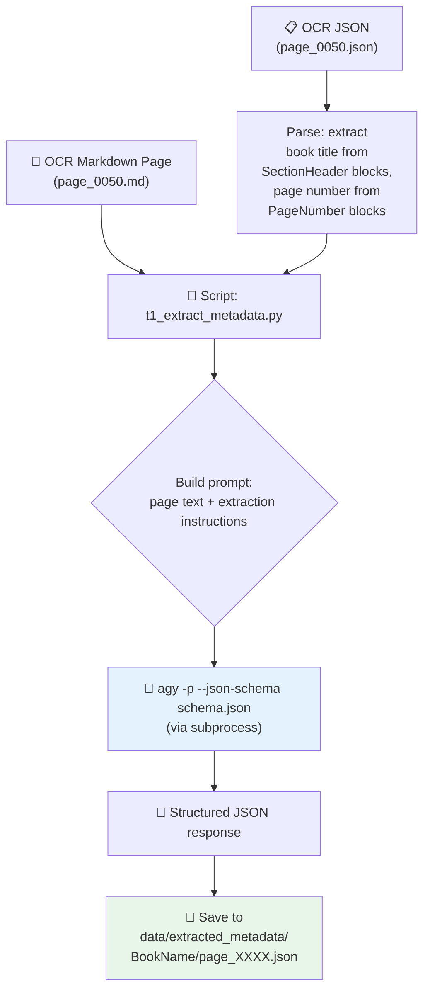
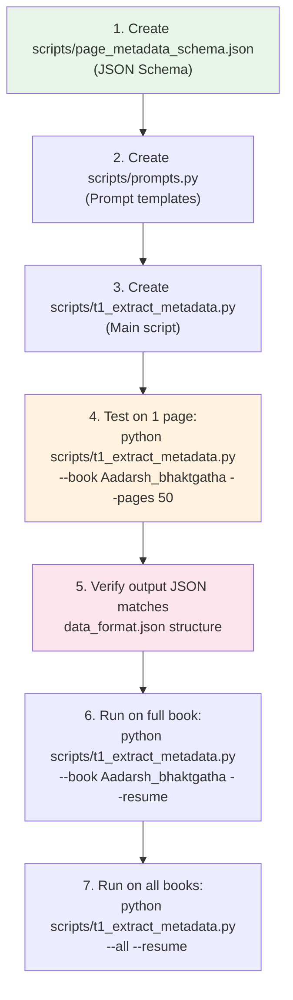

# 📋 Plan: LLM-Powered Metadata Extraction Script

## Goal

Build a Python script (`scripts/t1_extract_metadata.py`) that reads each OCR markdown page, sends it to an LLM via **Antigravity CLI** (`agy -p --json-schema`), and produces a structured JSON file matching the [data_format.json](file:///home/yogesh/Documents/repos/find-book-reference/data_format.json) schema — for every page of every book.

---

## Understanding the Data

### Input (what we have)
- **26 books** in [data/ocr_output/](file:///home/yogesh/Documents/repos/find-book-reference/data/ocr_output/)
- Each book has `raw/markdown/page_XXXX.md` files (~252 pages per book)
- Markdown contains: Gujarati prose, Sanskrit shlokas, page numbers (`$$84$$`), section headers, person/place names
- Also has `raw/json/page_XXXX.json` with structured blocks (paragraph, section headers, page numbers with bounding boxes)

### Output (what we want)
For each page, a JSON like:
```json
{
    "book_name": {
        "gujarati": "આદર્શ ભક્ત ગાથા",
        "english": "Aadarsh Bhaktgatha"
    },
    "book_page_no": "84",
    "content_page_no": "143",
    "persons_mentioned": ["કલ્યાણભાઈ", "મયારામ ભટ્ટ", "શ્રીજી મહારાજ"],
    "places_mentioned": ["વંથળી", "મેઘપુર", "સોરઠ"],
    "dates_mentioned": [],
    "festivals_events_mentioned": ["ચોરાશી"],
    "text_content": "અષ્ટાંગ યોગ, સાંખ્ય, તપ..."
}
```

---

## Architecture



---

## Detailed Script Plan

### File: `scripts/t1_extract_metadata.py`

#### 1. CLI Arguments (via `argparse`)

| Argument | Type | Default | Description |
|----------|------|---------|-------------|
| `--book` | `str` | `None` | Process a single book by folder name (e.g., `Aadarsh_bhaktgatha`) |
| `--all` | `flag` | `False` | Process all books |
| `--pages` | `str` | `None` | Page range like `1-50` or `50` (single page). Only with `--book` |
| `--output-dir` | `str` | `data/extracted_metadata` | Where to save output JSONs |
| `--model` | `str` | `None` | Override agy model (passed as `--model` to agy) |
| `--effort` | `str` | `low` | Reasoning effort for agy (`low`/`medium`/`high`) |
| `--concurrency` | `int` | `1` | Number of parallel agy invocations |
| `--resume` | `flag` | `False` | Skip pages that already have output JSONs |
| `--dry-run` | `flag` | `False` | Print what would be processed without calling LLM |
| `--use-openai` | `flag` | `False` | Use OpenAI-compatible API at localhost:8080 instead of agy |
| `--openai-url` | `str` | `http://localhost:8080` | OpenAI-compatible API base URL |

**Usage examples:**
```bash
# Single book, all pages
python scripts/t1_extract_metadata.py --book Aadarsh_bhaktgatha

# Single book, page range
python scripts/t1_extract_metadata.py --book Aadarsh_bhaktgatha --pages 50-60

# All books, resume from where we left off
python scripts/t1_extract_metadata.py --all --resume

# Dry run to see what would be processed
python scripts/t1_extract_metadata.py --all --dry-run

# Use local llama-serve instead of agy
python scripts/t1_extract_metadata.py --book Aadarsh_bhaktgatha --use-openai
```

#### 2. JSON Schema File: `scripts/page_metadata_schema.json`

This is the enforced output schema passed to `agy --json-schema`:

```json
{
    "$schema": "http://json-schema.org/draft-07/schema#",
    "type": "object",
    "required": ["book_name", "book_page_no", "content_page_no", "persons_mentioned", "places_mentioned",
                 "dates_mentioned", "festivals_events_mentioned", "text_content"],
    "properties": {
        "book_name": {
            "type": "object",
            "required": ["gujarati", "english"],
            "properties": {
                "gujarati": {
                    "type": "string",
                    "description": "The name of the book in Gujarati (e.g., આદર્શ ભક્ત ગાથા)"
                },
                "english": {
                    "type": "string",
                    "description": "The name of the book in English or transliterated (e.g., Aadarsh Bhaktgatha)"
                }
            },
            "additionalProperties": false
        },
        "book_page_no": {
            "type": "string",
            "description": "The page sequence number derived from the file name (e.g., '84' for page_0084.md/json)."
        },
        "content_page_no": {
            "type": "string",
            "description": "The page number as found in the text content (e.g., 84, ૮૫, 143, ૧૫૨). Return empty string if not found."
        },
        "persons_mentioned": {
            "type": "array",
            "items": {"type": "string"},
            "description": "All person names mentioned on this page."
        },
        "places_mentioned": {
            "type": "array",
            "items": {"type": "string"},
            "description": "All place names mentioned on this page."
        },
        "dates_mentioned": {
            "type": "array",
            "items": {"type": "string"},
            "description": "All dates mentioned, in their original format."
        },
        "festivals_events_mentioned": {
            "type": "array",
            "items": {"type": "string"},
            "description": "All festivals/events/ceremonies mentioned."
        },
        "text_content": {
            "type": "string",
            "description": "Full page text, cleaned of page number markers."
        }
    },
    "additionalProperties": false
}
```

#### 3. Core Functions

```python
def load_page_text(book_dir: Path, page_num: int) -> str:
    """Read the markdown file for a given page."""

def get_book_title_from_ocr_json(book_dir: Path, page_num: int) -> str | None:
    """Parse OCR JSON to find SectionHeader blocks for book title."""

def get_page_list(book_dir: Path) -> list[int]:
    """Get sorted list of available page numbers for a book."""

def build_prompt(page_text: str, book_folder_name: str,
                 book_title_hint: str | None) -> str:
    """Build the extraction prompt with instructions + page text."""

def call_agy(prompt: str, schema_path: str,
             model: str | None, effort: str) -> dict:
    """Call agy -p --json-schema via subprocess. Returns parsed dict."""

def call_openai_api(prompt: str, schema: dict, base_url: str) -> dict:
    """Fallback: call localhost:8080 OpenAI-compatible API."""

def process_page(book_dir, page_num, output_dir, config) -> dict:
    """Process a single page: load → prompt → call LLM → save."""

def process_book(book_name, data_dir, output_dir, config) -> dict:
    """Process all pages of a book. Returns stats."""
```

#### 4. The Prompt (Critical Design)

```text
You are a metadata extraction assistant for Gujarati religious scripture books.

Given the text content of a single page from a book, extract the following information:

1. **book_name**: An object with the book name in both Gujarati and English:
   - "gujarati": The name of the book in Gujarati. Hint: section headers on the page may contain the book title "{book_title_hint}".
   - "english": The name of the book in English / transliterated. Hint: the book folder name is "{book_folder_name}".

2. **book_page_no**: The page sequence number derived from the file name ("{file_page_no}").

3. **content_page_no**: The page number as it appears in the text. Look for patterns
   like $$84$$, $૮૫$, $$143$$, or standalone numbers. If no page number is found, return an empty string.

3. **persons_mentioned**: Extract ALL person names. These include:
   - Saints and spiritual leaders (e.g., શ્રીજી મહારાજ, ગુણાતીતાનંદ સ્વામી)
   - Devotees/bhakts (e.g., કલ્યાણભાઈ, મયારામ ભટ્ટ)
   - Historical figures
   - Deities (e.g., શ્રી કૃષ્ણ, નારાયણ)
   Use the exact form as written in the text.

4. **places_mentioned**: Extract ALL place names:
   - Villages and cities (e.g., વંથળી, ગઢડા, ભાવનગર)
   - Temples (e.g., વડતાલ મંદિર)
   - Regions (e.g., સોરઠ, કચ્છ)
   - Rivers, mountains, etc.

5. **dates_mentioned**: Extract ALL dates in their original format. Examples:
   - સંવત ૧૮૬૧ના ચૈત્ર મહિનાની સુદ નવમી
   - ઈ.સ. ૧૮૩૦
   - તા. ૧૩/૬/૧૮૪૬
   - 22 July 1933

6. **festivals_events_mentioned**: Extract festivals, religious events, or
   ceremonies (e.g., ફૂલદોલ ઉત્સવ, ચોરાશી, જન્માષ્ટમી).

7. **text_content**: The full text of the page with page number markers
   removed ($$84$$, $૮૫$, etc.) and extra whitespace normalized.

If a field has no matches, return an empty array [].

PAGE TEXT:
---
{page_text}
---
```

#### 5. AGY CLI Invocation

```bash
echo "<prompt>" | agy -p \
    --json-schema scripts/page_metadata_schema.json \
    --output-format json \
    --effort low \
    --model "gemini-2.5-flash" \
    --disable-slash-commands
```

> [!IMPORTANT]
> **Key flags:**
> - `--json-schema` enforces the output conforms to our schema
> - `--output-format json` returns machine-parseable JSON
> - `--effort low` keeps it fast and cheap (entity extraction doesn't need deep reasoning)
> - `--disable-slash-commands` prevents prompt content from triggering slash commands
> - Prompt is piped via **stdin** to avoid shell escaping issues with Gujarati text

In Python:
```python
import subprocess, json

def call_agy(prompt: str, schema_path: str,
             model: str | None, effort: str) -> dict:
    cmd = [
        "agy", "-p",
        "--json-schema", schema_path,
        "--output-format", "json",
        "--effort", effort,
        "--disable-slash-commands",
    ]
    if model:
        cmd.extend(["--model", model])

    result = subprocess.run(
        cmd,
        input=prompt,
        capture_output=True,
        text=True,
        timeout=120,  # 2 min timeout per page
    )

    if result.returncode != 0:
        raise RuntimeError(f"agy failed: {result.stderr}")

    return json.loads(result.stdout)
```

#### 6. OpenAI-Compatible API Fallback

For `--use-openai` mode (localhost:8080):

```python
import requests

def call_openai_api(prompt: str, schema: dict, base_url: str) -> dict:
    response = requests.post(
        f"{base_url}/v1/chat/completions",
        json={
            "model": "local-model",
            "messages": [
                {"role": "system", "content": "You are a metadata extraction assistant. "
                 "Respond ONLY with valid JSON matching the provided schema."},
                {"role": "user", "content": prompt},
            ],
            "temperature": 0.1,
            "max_tokens": 4096,
            "response_format": {"type": "json_object"},
        },
        timeout=120,
    )
    response.raise_for_status()
    content = response.json()["choices"][0]["message"]["content"]
    return json.loads(content)
```

#### 7. Output Directory Structure

```
data/extracted_metadata/
├── Aadarsh_bhaktgatha/
│   ├── page_0001.json     ← structured metadata
│   ├── page_0002.json
│   ├── ...
│   └── page_0252.json
├── HCC_PART_1/
│   ├── page_0001.json
│   └── ...
├── _progress.json          ← tracks which books/pages are done
└── _summary.json           ← aggregate stats
```

#### 8. Progress Tracking & Resume

The script maintains a `_progress.json` file:

```json
{
    "Aadarsh_bhaktgatha": {
        "total_pages": 252,
        "processed_pages": [1, 2, 3, 120],
        "failed_pages": [45, 67],
        "last_updated": "2026-10-10T12:30:00"
    }
}
```

When `--resume` is used, pages already in `processed_pages` are skipped.
Failed pages are retried on each run.

#### 9. Error Handling

| Error | Strategy |
|-------|----------|
| AGY subprocess timeout | Log, mark page as failed, continue to next page |
| AGY returns invalid JSON | Log raw output, retry once, then mark as failed |
| JSON doesn't match schema | Log, save raw response to `_errors/` dir, mark as failed |
| Network error (OpenAI mode) | Retry 3 times with exponential backoff |
| Missing markdown file | Log warning, skip page |
| Rate limiting | Exponential backoff (0.5s, 1s, 2s, 4s...) between calls |

#### 10. Concurrency (Optional)

When `--concurrency > 1`, use `concurrent.futures.ThreadPoolExecutor` to run multiple `agy` subprocesses in parallel. Each thread processes a different page independently.

> [!WARNING]
> AGY CLI may have its own rate limits. Start with `--concurrency 1` and test before increasing.

---

## Files to Create

| File | Purpose |
|------|---------|
| [`scripts/page_metadata_schema.json`](file:///home/yogesh/Documents/repos/find-book-reference/scripts/page_metadata_schema.json) | JSON Schema for the output format |
| [`scripts/prompts.py`](file:///home/yogesh/Documents/repos/find-book-reference/scripts/prompts.py) | Prompt templates (keeps main script clean) |
| [`scripts/t1_extract_metadata.py`](file:///home/yogesh/Documents/repos/find-book-reference/scripts/t1_extract_metadata.py) | Main script — orchestrates everything |

---

## Execution Order



---

## Estimated Time & Cost

| Scope | Pages | Estimated Time (agy, effort=low) | Notes |
|-------|-------|----------------------------------|-------|
| 1 page test | 1 | ~5-10 seconds | Quick validation |
| 1 book (252 pages) | 252 | ~10-20 minutes | Depends on model and rate limits |
| All 26 books (~7,000 pages) | ~7,000 | ~4-8 hours | Use `--resume` to restart safely |

> [!TIP]
> Using `--effort low` with a fast model like `gemini-2.5-flash` will be the fastest and cheapest option. Entity extraction is a straightforward task that doesn't need deep reasoning.

---

## Open Decisions

1. **Should `text_content` be cleaned by the LLM or by Python post-processing?**
   → Recommendation: **Python post-processing** is more reliable. Strip `$$84$$` and `$૮૫$` markers with a simple regex. Let the LLM focus on entity extraction.

2. **Should we parse OCR JSON blocks for pre-seeding book name and page number?**
   → Recommendation: **Yes**. The OCR JSON has `SectionHeader` (book title) and `PageNumber` blocks with high confidence. Extract these deterministically and pass as hints to the LLM, reducing hallucination.

3. **Per-page JSONs or a single combined JSON per book?**
   → Recommendation: **Per-page JSONs** during extraction (fault-tolerant), then a `scripts/merge_metadata.py` script to combine into per-book JSONs later.
